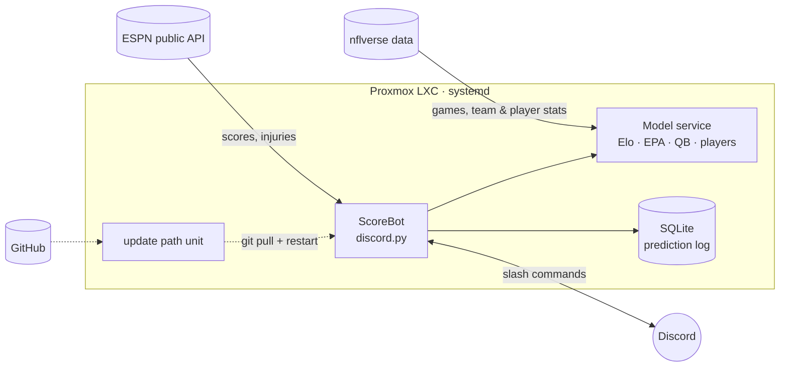

# ScoreBot

A self-hosted Discord bot for sports scores and NFL analytics. It posts live scores for six sports and runs its own NFL model, built from scratch in pure Python: win probabilities, projected scores, power rankings, and player stat projections, with an honest scorecard of how accurate it is.

It's built to run 24/7 in a Linux container, like the rest of my [home lab](https://github.com/joshwhite258/Homelab).

## What it does

| Command | What you get |
|---|---|
| `/scores` | Live scores and today's schedule for football, basketball, baseball, hockey, soccer and tennis. Filter by team, or look at yesterday and tomorrow. |
| `/nfl predict` | This week's win chances, projected margins and scores. Add `team:` for the full breakdown, including quarterback changes. |
| `/nfl power` | Power rankings from Elo plus offensive and defensive EPA per play. |
| `/nfl player` | A player's projected stats for his next game, each with an 80% range. |
| `/nfl report` | Backtest accuracy against simpler baselines, calibration, player-projection error, and the live track record. |
| `/injuries` | An NFL team's current injury report. |
| `/scorebot …` | `help`, `status`, `setchannel` and `digest` for the weekly preview, and `update` to deploy from Discord. |

A weekly preview with every game's projection, the top of the power rankings and the season's track record posts automatically to each server's chosen channel.

## How the NFL model works

Everything is computed from public NFL data ([nflverse](https://github.com/nflverse)) going back to 1999. There's no pandas or scikit-learn: the regression, rating systems and evaluation fit in under 500 lines of plain Python.

**Team strength** comes from three signals:

- **Elo**, with home-field advantage, margin-of-victory scaling and regression to the mean between seasons.
- **EPA per play** (expected points added), exponentially weighted for offense and defense separately, and shrunk toward zero early in a season.
- **Quarterback value**: team pass EPA per dropback in each QB's starts. When a backup starts, the model adjusts by the gap between him and the usual starter. Starters are detected from the schedule, the official injury report and ESPN's live injury feed.

**Win probability** blends those three with a logistic regression, written as Newton–Raphson with L2 regularisation. **Projected margin** maps that probability through the spread of NFL results (SD ≈ 13.5 points). **Projected total** comes from exponentially weighted points scored and allowed, linearly calibrated on history.

**Player projections** use a player's recent per-game production, shrunk toward his position's average, then scaled by what the opponent's defense allows relative to the league and by how many points the team model projects his team to score. Yardage gets a normal distribution with an error that grows with the projection. Counts like receptions and touchdowns get a Poisson distribution. Those distributions produce the 80% range.

### How good is it?

Weights are fit on all games except the two most recent seasons, then scored on those held-out games:

| Held-out 2025 + 2026 (363 games) | ScoreBot | Elo alone | Always pick home |
|---|---|---|---|
| Winners picked | **63.9%** | 63.4% | 53.4% |
| Log loss (lower is better) | **0.628** | 0.636 | 0.693 |

- **Calibration:** when it says a favourite wins 70–80% of the time, they won 74% of the time.
- **Game totals:** off by 13.6 points on average, against 14.1 for guessing the league average.
- **Player projections:** matched or beat a plain weighted average for every stat type last season, with the clearest gains on yardage (2–4% smaller errors).

Backtests can flatter a model, so ScoreBot also **freezes every prediction before kickoff and grades it after the game**. That live record is in `/nfl report` and the weekly preview. Figures above are from the October 2026 rebuild. The model retrains every six hours as new data lands.

## Architecture



Some engineering details:

- **Polite API client.** ESPN's CDN rejects bursts, so every call is spaced out, retried once on 403/429, and backs off for five minutes after repeated blocks rather than hammering the API.
- **Background jobs.** The model rebuilds every 6 hours, injuries refresh every 20 minutes, and the preview checks every 30 minutes. Downloads are cached, and past seasons are only fetched once.
- **Deploy from Discord.** The bot runs as an unprivileged user and can't restart itself. `/scorebot update` drops a request file, and a root systemd path unit sees it, pulls from GitHub, reinstalls, restarts, and leaves a result the bot posts back to the channel. A daily cron job does the same automatically.
- **Tests.** Pytest covers the rating systems, the regression (it recovers known weights from synthetic data), player projections, scoreboard and injury parsing, the prediction log, the command tree and the updater script end to end.

## Running it

**Requirements:** Python 3.11+ and a Discord bot token.

```bash
git clone https://github.com/joshwhite258/ScoreBot.git && cd ScoreBot
python3 -m venv venv && . venv/bin/activate
pip install -r requirements.txt
cp .env.example .env        # add DISCORD_TOKEN
python -m scorebot
```

The first start downloads about 20 MB of nflverse data and builds the model in under 10 seconds.

**On a Debian 12 server or LXC** (installs a `scorebot` system user, a virtualenv, the systemd service and the updater):

```bash
sudo bash deploy/install.sh
sudo nano /opt/scorebot/.env
sudo systemctl start scorebot && journalctl -u scorebot -f
```

To deploy automatically, add `30 4 * * * bash /root/ScoreBot/deploy/auto-update.sh >> /var/log/scorebot-update.log 2>&1` to cron.

**Tests:**

```bash
pip install -r requirements-dev.txt && python -m pytest
```

## Project layout

```
scorebot/
  bot.py            client, background jobs
  scores.py         ESPN scoreboard parsing (team sports + tennis)
  espn.py           rate-limited ESPN client
  injuries.py       ESPN injury feed
  predictions.py    pre-kickoff prediction log + grading
  digest.py         weekly preview
  models/
    nflverse.py     data download + CSV parsing
    ratings.py      Elo, EPA, QB value, totals, logistic blend, backtest
    players.py      player stat projections + ranges
    service.py      keeps models fresh, answers queries
  cogs/             slash commands
deploy/             installer, systemd units, auto-update
tests/
```

## Data

Team and player statistics come from [nflverse](https://github.com/nflverse). Scores, schedules and injuries come from ESPN's public site API, which is unofficial and unaffiliated. ScoreBot is a personal project.
